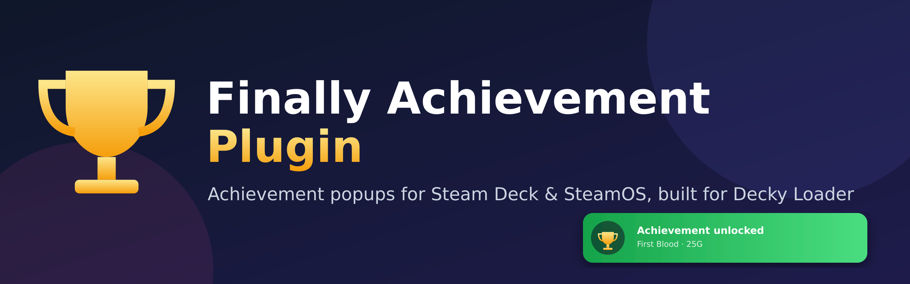
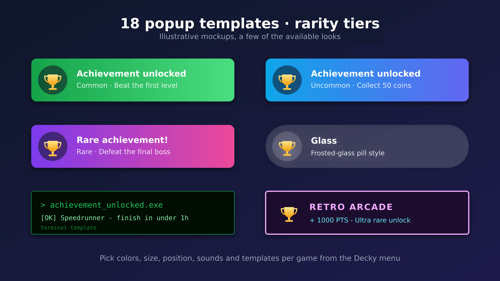
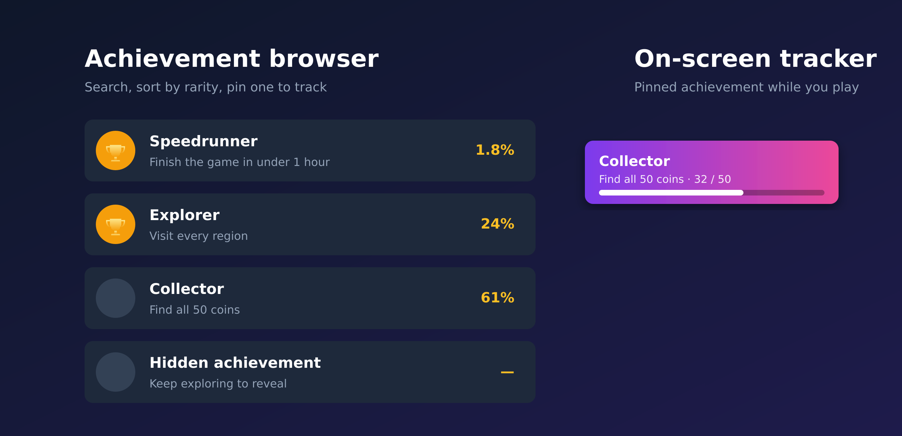

<p align="center">
  
</p>

<h1 align="center">Finally Achievement Plugin</h1>

<p align="center">
  <b>Console-style achievement popups for Steam Deck, right in Gaming Mode.</b><br>
  Pick a look, hear a sound that fits how rare the unlock was, and keep track of what is left.
</p>

<p align="center">
  
  
  
  
</p>

<p align="center">
  <video src="https://github.com/otisabiburada/finally-achievement-plugin/blob/main/docs/IMG_8089.gif" controls muted loop playsinline width="80%"></video>
  <br>
  <sub>If the video does not play here, <a href="docs/demo.mp4">open the demo clip</a>.</sub>
</p>

---

Steam on the Deck unlocks achievements quietly. **Finally Achievement Plugin** fixes that: the moment you unlock one, a popup slides in over your game with its real icon, name, description and how few players have it. Rare unlocks look and sound different, so you notice the ones that matter.

## What you get

| | |
|---|---|
| **19 popup templates** | Xbox, Xbox 360, a **PS3 trophy bar**, Steam, Material, retro arcade, terminal, glass, game-art blur and more. Your colors, size, position and timing. |
| **Live preview** | The Decky panel plays the selected template as a looping animation, so you can see a change without waiting for a test popup. |
| **Rarity tiers** | Common, uncommon, rare and ultra rare popups, each with its own sound. Add your own `.wav`, `.flac`, `.ogg` or `.mp3`. |
| **Screenshot on unlock** | Optional. Saves a picture of your game (or of the game with the popup) every time you unlock something. |
| **Achievement browser** | Every achievement of the running game, locked and unlocked, with rarity and unlock date. Secret ones stay hidden until unlocked. |
| **On-screen tracker** | Pin an achievement and follow it while you play, in the same look as your popups. |
| **Per-game settings** | A different style or sound for a particular game. |
| **Milestones and history** | 100% completion popup, "only 2 left" alerts, a session summary and an unlock history with shareable cards. |
| **Fast and local** | Unlocks are read from Steam's own files within about a second. No account or API key needed (a Steam Web API key is an optional fallback). |
| **9 languages** | English, Turkish, German, French, Spanish, Brazilian Portuguese, Russian, Polish and Simplified Chinese, following your Steam language. |

<p align="center">
  
</p>

<p align="center">
  
</p>

> The two images above are illustrative mockups. The video at the top is a real clip.

## Quick start

1. Install [Decky Loader](https://decky.xyz) on your Steam Deck.
2. Install this plugin (see [Install](#install-finally-achievement-plugin) below, about 5 minutes).
3. Open the Decky menu, choose **Finally Achievement Plugin**, pick a template under *Appearance* and watch the preview.
4. Play. Your next unlock shows up with the popup you picked.

## What You Need

- A Steam Deck or SteamOS device.
- Decky Loader installed.
- A working internet connection on the Steam Deck.
- About 5 minutes.

If Decky Loader is not installed yet, install it first from:

[https://decky.xyz](https://decky.xyz)

## Install Finally Achievement Plugin

This is the easiest method. You only need to copy and paste commands.

1. Hold the power button on your Steam Deck.
2. Choose `Switch to Desktop`.
3. Open the app called `Konsole`.
4. Copy this whole block and paste it into Konsole:

```bash
mkdir -p ~/homebrew/plugins
cd ~/Downloads
rm -rf finally.zip finally-achievement-plugin-main
curl -L https://github.com/otisabiburada/finally-achievement-plugin/archive/refs/heads/main.zip -o finally.zip
unzip finally.zip
rm -rf "$HOME/homebrew/plugins/Finally Achievement Plugin"
mv finally-achievement-plugin-main "$HOME/homebrew/plugins/Finally Achievement Plugin"
chmod +x "$HOME/homebrew/plugins/Finally Achievement Plugin/finally_gamescope_overlay.py" "$HOME/homebrew/plugins/Finally Achievement Plugin/tracker_overlay.py"
```

5. Restart Decky Loader with this command:

```bash
sudo systemctl restart plugin_loader
```

6. If SteamOS asks for a password, enter your Deck sudo password.
7. If you do not know the sudo password, just restart the Steam Deck instead.
8. Go back to Gaming Mode.
9. Open the Decky menu.
10. You should see `Finally Achievement Plugin`.

The plugin folder must be exactly here:

```text
/home/deck/homebrew/plugins/Finally Achievement Plugin
```

Do not put it in `Downloads`, and do not leave it inside another folder like `finally-achievement-plugin-main/Finally Achievement Plugin`.

## Manual Install With Dolphin

Use this if you do not want to paste commands.

1. Switch to Desktop Mode.
2. Open this page in a browser:

[https://github.com/otisabiburada/finally-achievement-plugin](https://github.com/otisabiburada/finally-achievement-plugin)

3. Press the green `Code` button.
4. Press `Download ZIP`.
5. Open the downloaded ZIP in Dolphin.
6. Extract it.
7. Rename the extracted folder to:

```text
Finally Achievement Plugin
```

8. Move that `Finally Achievement Plugin` folder to:

```text
/home/deck/homebrew/plugins/
```

The final path should look like this:

```text
/home/deck/homebrew/plugins/Finally Achievement Plugin/plugin.json
/home/deck/homebrew/plugins/Finally Achievement Plugin/main.py
/home/deck/homebrew/plugins/Finally Achievement Plugin/dist/index.js
```

9. Restart the Steam Deck.
10. Open Decky in Gaming Mode and look for `Finally Achievement Plugin`.

## Install from a release zip

Download `Finally-Achievement-Plugin.zip` from the [latest release](https://github.com/otisabiburada/finally-achievement-plugin/releases/latest). On the Deck, open Decky > Settings > Developer, turn on Developer mode, and choose "Install plugin from ZIP file" (or "Install plugin from URL" with the release link). The release already contains everything, so nothing needs to be built.

## Update Finally Achievement Plugin

To update to the newest GitHub version:

1. Switch to Desktop Mode.
2. Open `Konsole`.
3. Paste this:

```bash
cd ~/Downloads
rm -rf finally.zip finally-achievement-plugin-main
curl -L https://github.com/otisabiburada/finally-achievement-plugin/archive/refs/heads/main.zip -o finally.zip
unzip finally.zip
rm -rf "$HOME/homebrew/plugins/Finally Achievement Plugin"
mv finally-achievement-plugin-main "$HOME/homebrew/plugins/Finally Achievement Plugin"
chmod +x "$HOME/homebrew/plugins/Finally Achievement Plugin/finally_gamescope_overlay.py" "$HOME/homebrew/plugins/Finally Achievement Plugin/tracker_overlay.py"
sudo systemctl restart plugin_loader
```

If the last command asks for a password you do not know, restart the Steam Deck instead.

Your Finally Achievement Plugin settings are stored separately, so updating the plugin should not remove your settings.

Settings are stored here:

```text
/home/deck/homebrew/settings/Finally Achievement Plugin/settings.json
```

## Remove Finally Achievement Plugin

1. Switch to Desktop Mode.
2. Open `Konsole`.
3. Paste this:

```bash
rm -rf "$HOME/homebrew/plugins/Finally Achievement Plugin"
sudo systemctl restart plugin_loader
```

If you cannot use `sudo`, restart the Steam Deck after deleting the folder.

## Settings

Inside the Decky menu, Finally Achievement Plugin has settings for:

- Popup size from `0%` to `100%`.
- Volume from `0%` to `100%`.
- Normal achievement sound.
- Rare achievement sound.
- Normal popup gradient colors.
- Rare popup gradient colors.

Default size is `50%`.

Default volume is `50%`.

## Troubleshooting

If Finally Achievement Plugin does not appear in Decky:

- Check that the folder is exactly `/home/deck/homebrew/plugins/Finally Achievement Plugin`.
- Check that `/home/deck/homebrew/plugins/Finally Achievement Plugin/plugin.json` exists.
- Restart the Steam Deck.

If you hear the sound but do not see the popup:

- Open Finally Achievement Plugin settings.
- Make sure popup size is not `0%`.
- Press `Test XBOX Popup`.
- Restart the Steam Deck if it still does not show.

If achievement popups repeat after a restart:

- Update Finally Achievement Plugin to the newest GitHub version.
- Restart the Steam Deck.

## Features

- Xbox-style achievement popup in-game.
- Real Steam achievement icon when Steam has one available.
- Special rare achievement animation.
- Normal and rare `.wav` sounds.
- Fast local SteamOS achievement detection.
- Optional Steam Web API fallback.
- Manual test buttons inside Decky.

## For Developers

The frontend in `src/` is compiled into `dist/index.js`, which Decky loads. **Build it before installing from a ZIP or publishing a release**, otherwise the plugin has no UI:

```bash
pnpm install
pnpm build
python3 -m py_compile main.py steamworks_probe.py steamworks_list_probe.py steamworks_track_probe.py finally_gamescope_overlay.py finally_cairo_ctypes.py finally_diagnose.py tracker_overlay.py
```

Deploy to a Steam Deck over SSH (the script needs your Deck's address and sudo password, nothing is stored in the repo):

```bash
TARGET_HOST=deck@steamdeck.local DECK_PASS='your-sudo-password' ./deploy.sh
```

The plugin folder on the Deck is:

```text
/home/deck/homebrew/plugins/Finally Achievement Plugin
```

## AI Disclosure

Parts of this plugin were developed with AI-assisted coding support. All generated code and content were manually reviewed, edited, and tested before publication.


## Achievement browser and tracker

The old separate achievements plugin is now built in. Open the Finally Achievement Plugin panel and switch **Show** to
**Achievements & tracker**. The panel is split into five views to keep each screen short: **Popup** (game settings,
appearance, rarity tiers), **Colors & style** (colors, glow, text), **Sound & tests**, **Achievements & tracker**
and **Advanced** (overlay check, icon accuracy / Web API key, watcher status):

- Browse every achievement of the running game (locked and unlocked) with rarity and unlock dates. Secret
  achievements stay hidden until unlocked.
- Search the list by typing part of a name or description (every word you type has to match), with a result count and a
  clear button. Sorting still applies to the results.
- Press the action button on an achievement to pin it as a small on-screen tracker.
- The tracker shows the achievement's description (or a progress count and bar when the game tracks one), has no drop shadow, and is drawn with your popup template and colors (including "Use each template's own colors" and the
  gradient options), and it slides away while a popup shows, then slides back.
- Tracker position, size and template are in the same view. The template defaults to "Same as popups"; pick any
  other (for example **Game Art Blur**) to give the tracker its own look.

Only one gamescope overlay window can be shown at a time, so the plugin manages it for both. If you used the old
plugin, remove it: your pinned achievement, position and size are carried over the first time this version starts.

## Game Art Blur template

A popup and tracker template that uses the running game's own artwork as the card background, blurred, under a
black vignette. Pick **Game Art Blur** in the template list. With no game running (or no artwork found) it falls
back to a plain dark card with the vignette.

## Template preview, PS3 Trophy and screenshots (v1.7.0)

- **Preview in the panel.** Under *Popup template* the panel plays a looping animation of the whole popup (entrance, hold and exit) for the selected template, drawn by the same renderer as the real popup with your colors, fonts and options. It takes a second or two to redraw after a change. *Preview as* switches between a common, uncommon, rare and ultra rare unlock. With a game running, its icon is used. The Test buttons still play the full popup.
- **PS3 Trophy template.** A dark, glossy rounded bar in the top right corner: the trophy picture on the left, name and description beside it, and a small cup on the right in the trophy's grade colour (common bronze, uncommon silver, rare gold, ultra rare platinum). It is drawn from scratch, not copied from Sony artwork.
- **Screenshot on unlock.** Turn it on under *Screenshot*. Pictures go to `Pictures/Finally Achievements/Screenshots` (the newest 500 are kept). By default the picture is the game at the moment of the unlock; *Include the popup* takes it a moment later so the popup is in it. *Test screenshot* takes one now. It asks gamescope for the picture, so it works in Game Mode.

## Near-instant popups and TV placement (v1.6.3)

Reported: the popup appeared 10-15 seconds after the achievement was earned.

- **Why it was late:** the unlock itself was noticed quickly, but before showing the popup the plugin waited, one after another, for the icon download, a check that the icon isn't the gray "locked" one, a fallback icon from the Steam Community page, the unlock percentage, the description and the game art. Each had its own multi-second network timeout, so together they could hold the popup back 10 seconds or more.
- **One-second budget:** those lookups now run at the same time, and the popup waits for them at most 1 second. Anything not ready by then is left out of that popup; it keeps loading in the background and is saved, so the next popup has it at once.
- **Unlock read at once:** a change to `UserGameStats_<account>_<appid>.bin` is now read the moment Linux reports it (inotify). Before, that signal was sent to the library data, which lags; the once-a-second scan is now a 0.25-second backup.
- **Downloaded ahead of time:** when a game starts, its unlock percentages, its icon and art, and the icons of achievements still locked are downloaded, and those icons are checked for gray, so an unlock's popup reads everything from disk.
- **Cheaper gray-icon check:** it runs in one helper that stays running instead of a new Python process per icon, and each icon's answer is saved in `icon-cache/color-verdicts.json`.
- **Display retries:** a display setup the popup couldn't open on is skipped for 10 minutes instead of being tried first on every popup. MangoApp is stopped while the unlock sound's lead-in plays instead of after it.
- **TV placement:** with the popup screen size on "auto", popups use the screen size Steam's own interface reports. On a TV the X display can be a different size (for example 1280x800 on a 1080p TV), which put popups in the wrong place.
- **Trade-off:** on a slow connection, the first unlock in a game may show without its percentage, or with the game's icon in place of the achievement's. Later unlocks have both.
- **Not yet confirmed on a Deck:** tested offline with simulated slow lookups (`tests/test_popup_latency.py`): the old code took 8.2 seconds to show the popup there, the new code under 1 second. If a popup is still late, send the plugin log line that starts with `Notification emitted via`.

## Instant unlock detection and descriptions (v1.6.2)

The same Steam Machine report (popup only after pressing the Steam button, 1-2 minutes late, or with just a title) was traced further.

- **New watcher:** Steam writes `appcache/stats/UserGameStats_<account>_<appid>.bin` as soon as a game stores an unlock. The plugin now checks those files once a second and reads the unlock straight from the file that changed, instead of waiting for Steam's library data (which only refreshes when the Steam interface does, for example when you press the Steam button). An unlock is announced about a second after Steam writes it. An unlock that another detection path shows first is never shown twice.
- **Descriptions:** names and descriptions now come first from Steam's own local schema file (`UserGameStatsSchema_<appid>.bin`). It holds every language and includes secret achievements, so there is no waiting and no 3-second cut-off. If that file has nothing, the helper lookup is tried up to 3 times instead of once.
- **Not confirmed on that machine:** this is based on how Steam's files look on a normal install (checked against real Steam files and covered by `tests/test_stats_bin.py`). If a popup is still late, open **Advanced** after an unlock, look at the watcher status and last source, and send the plugin log.

## Popup late, or without a description (v1.6.1)

Reported on a Steam Machine: the popup only appeared after pressing the Steam button, or 1-2 minutes late, and then without a description.

- The achievement helper now asks Steam to resend the game's stats every 2 seconds, so an unlock made by the game is noticed promptly. (This is my best explanation of the delay and is not confirmed on that machine; if it still happens, open **Advanced** after an unlock and look at the watcher status and the last source, and send the plugin log.)
- The Steam library the helper needs is now also looked for under your own Steam install (other user names, Flatpak Steam), not only `/home/deck`.
- When a popup arrives without a description (secret achievements have none in Steam's web data), the plugin asks Steam for it, once, and waits at most 3 seconds.

## History, share cards and milestone popups (v1.6.0)

Open the panel and choose **History & sharing** in the "Show" dropdown.

- **Recent Unlocks** lists what you unlocked, with the game, rarity and time. History starts from the day you install 1.6.0 (the last 500 unlocks are kept in `history.json` in the plugin's settings folder). **Clear history** empties it.
- **Share card:** select an unlock to make a 1200 x 630 image card (icon, name, description, rarity, game, date). It is saved to `Pictures/Finally Achievements` in your home folder, and the panel shows a preview and the path. The plugin does not post anywhere; open the file from Desktop Mode (or copy it off the device) to share it.
- **Session summary:** when you close a game, one popup such as "3 unlocked, 1 rare". Only appears if you unlocked something during that session.
- **Almost there alert:** after an unlock, a popup such as "Only 2 achievements left" once a game is down to the number you choose (1 to 5). Shown once per remaining count, not for finished games, and not for games with very few achievements.

Both milestone popups use the same look as the 100% popup and follow your volume, size and position settings. Use the test buttons in the same view to preview them.

## Languages (v1.5.0)

The panel and the popups are available in English, Turkish (Turkce), German, French, Spanish, Portuguese (Brazil), Russian, Simplified Chinese and Polish (Polski, added in 1.6.1).

- **Auto** (default) follows the language of the Steam client. Pick another one with **Language** at the top of the panel.
- Popups, the pinned tracker and the achievement text fetched from Steam use it too. Achievement names and descriptions always follow Steam's own language, which is what Steam shows in its popups.
- The detailed status dump under **Advanced** stays in English on purpose.
- **Simplified Chinese** needs a Chinese font for the popups. The plugin uses an installed one (Noto Sans SC, Source Han Sans, WenQuanYi...). If none is found the panel says so: copy a `.ttf`/`.otf`/`.ttc` font file into `~/homebrew/settings/Finally Achievement Plugin/fonts/` (the panel shows the exact folder) and run a test popup.
- The translations were written by an AI. Corrections are very welcome as pull requests.

### Adding or fixing a translation

Translations live in `locales/<code>.json` as `"English text": "translation"`; the English text is the key, so anything missing just shows in English. They are generated from `tools/locale_src.py`:

1. Edit `tools/locale_src.py` (one line per string, one column per language, keep `{placeholders}` unchanged). Polish lives in `tools/locale_pl.py` (English text -> Polish).
2. Run `python3 tools/write_locales.py`. It rewrites `locales/*.json` and `src/locales.ts` and reports missing or unused strings.
3. Rebuild the panel (`pnpm build`).

To add a language, add its code to `ORDER` and `NAMES` there, to `SUPPORTED` in `finally_i18n.py` and `src/i18n.ts`, to `LANGUAGE_CHOICES` in `main.py`, and a column to every entry.

## Popups in the wrong place on a TV (v1.4.1)

When the device is connected to a TV, gamescope can scale the popup canvas
differently from the screen size the X display reports, so the popups land in
the wrong spot. In **Appearance** there is now a **Popup screen size** setting
and a **Show screen frame** button:

1. Leave it on **Auto** on the Steam Deck's own screen.
2. On a TV, press **Show screen frame**. A red frame (yellow block = top left)
   appears for a few seconds. It should sit exactly on the screen edges.
3. If it doesn't, pick the TV's resolution (or the one that makes the frame fit)
   and press the button again. The size applies to the popups and the tracker.

The size is per device: it is not part of a per-game profile.

## No popup sound (v1.4.1)

The sound used to be tagged `media.role=event`, which some setups (Steam
Machine, TVs over HDMI) route to nothing. The tag is gone, so the sound plays
on the normal output. If you applied the `sed` workaround from the GitHub issue,
you don't need it any more.

## Sound plays but no popup shows

The popup is drawn by a helper process that needs a working display, Python graphics packages and OpenGL. The plugin
detects the X display and runtime folder automatically (it used to assume a Steam Deck's `:0` and `/run/user/1000`)
and retries another display if the first can't be reached. If popups still don't appear, open the **Advanced** view
and press **Run overlay check**. It tests each requirement (pycairo, PyGObject and its typelibs, GLFW, OpenGL, X11,
display connection, creating a transparent window) and tells you which one is missing. The result also shows the last
popup's error. Send that to whoever is helping you.

## Sounds per popup type, and your own sounds

**Sound & tests** has one sound for each popup type: common, uncommon, rare, ultra rare and the completionist
popup. Uncommon and ultra rare sounds need **Rarity Tiers** on (otherwise common/rare sounds play, as before). The
defaults are the same two sounds the plugin always used, so nothing changes until you pick something.

To use your own sounds, put files (.wav, .flac, .ogg, .mp3 or .aiff, 10 MB or less) in
`~/homebrew/settings/Finally Achievement Plugin/sounds/`, press **Refresh sound list** in the panel, and pick them (they're shown with
"(yours)"). That folder is kept when the plugin is updated. Notes:

- Keep them short: a sound is cut off after about 20 seconds.
- A file of yours with the same name as a bundled sound replaces it.
- The bundled `*_preroll` sounds begin with a short silence so the sound lines up with the popup; your files start
  immediately, and the popup no longer waits for them.
- Playback goes through `paplay`, so the formats available depend on the system's libsndfile (WAV and FLAC always;
  OGG and MP3 on current SteamOS).
- Each game's own settings can use different sounds too.

## Tier sounds (bundled)

Four original synthesized sounds are bundled for the per-tier sound slots: `finally_common.wav`, `finally_uncommon.wav`,
`finally_rare.wav` and `finally_ultra_rare.wav`. They share one character (a cinematic swell into a bright hit, glassy
bell shimmer in F sharp major, a fast sparkle run and a long reverb tail) and get bigger with rarity: about 1.2 s, 1.8 s,
4 s and 7.7 s, with loudness stepping up about 3 dB per tier. Choose them in **Sound & tests**. They are not the
defaults, so nothing changes until you pick them. `tools/make_tier_sounds.py` regenerates them.

## Percentage badge position

By default the "4.7% of players" badge sits in the bottom right of the popup, which narrows the description beside it.
Set **Percentage badge position** (Popup view, Appearance) to **Top right** to move the badge to the top right corner.
The description then gets the card's full width, so short descriptions no longer end in "...", and longer ones can use
two lines. On the pill-shaped Xbox 360 templates the badge is kept inside the curved end, and on Chat Toast the "now"
stamp moves left of it.

## Colored (unlocked) achievement icons

Popups should always use the unlocked, colored icon, never the gray locked one. The icon is chosen from these sources,
best first, and every non-Steam-schema icon is checked for being gray before it's used:
1. Steam's Web API schema (needs your key).
2. Steam's own local achievement data (`appcache/stats/UserGameStatsSchema_<appid>.bin`), which lists each
   achievement's colored and gray icon. No key or network needed.
3. Steam's local library cache icon. If it looks gray (or can't be checked), the public Steam achievements page is
   tried, then the cache is re-read for up to about 3.4 seconds while Steam updates it.
The panel's Achievement Icon Accuracy section shows which source the last popup used. If only a gray icon exists, it
says so rather than guessing.

## "Authorization required" / popup crashes on start

If the popup helper can't reach the X display because an X authorization cookie is needed, the plugin now finds the
cookie the Steam client uses (and a few standard locations), tries display and cookie combinations (up to five), and
remembers the one that works. The helper also checks the display before loading graphics libraries, so a refused
connection ends with a clear message instead of crashing.

## Devices without pycairo (Legion Go and other handhelds)

SteamOS ships pycairo and PyGObject, but other handheld images often don't, and the popup used to fail there with
"No module named 'cairo'" (sound played, no popup). The renderer now falls back to `finally_cairo_ctypes.py`, which
draws through the system `libcairo`, `libpango`, `libpangocairo`, `libgdk_pixbuf` and `libgobject` using ctypes. It
provides only the calls the renderer uses and needs no Python packages at all. On a Steam Deck nothing changes
(pycairo + PyGObject are still used). Set `FINALLY_FORCE_CTYPES_DRAWING=1` to force the ctypes layer.

The overlay check (Advanced view) now reports which drawing libraries are in use, and treats a missing pycairo or
PyGObject as informational when the system libraries are present. The popup window itself still needs GLFW 3,
OpenGL and X11 libraries; the check says if one of those is missing.
